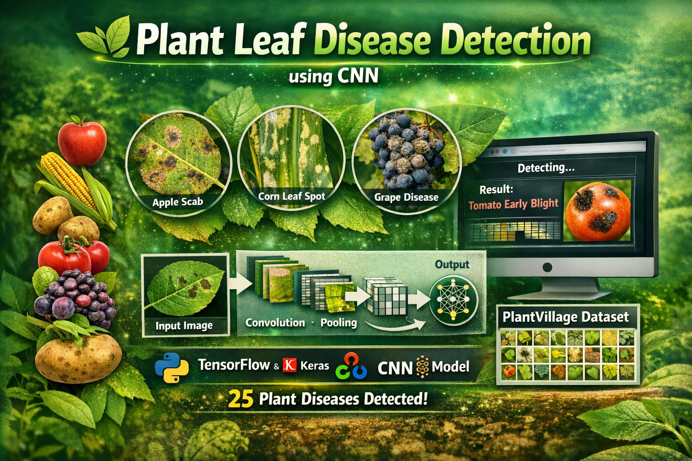

<p align="center">
  
</p>

# 🌿 Plant Leaf Disease Detection using CNN

## 📌 Project Overview
This project implements a **Deep Learning based Plant Leaf Disease Detection system** using a **Convolutional Neural Network (CNN)**.  
The model is trained to classify plant leaf diseases from images using the **PlantVillage dataset**.

The system can predict diseases from crops such as:

- Apple
- Corn (Maize)
- Grape
- Potato
- Tomato

It detects **25 different plant disease classes** and identifies whether a plant leaf is healthy or infected.

---

## 🧠 Technologies Used

- Python
- TensorFlow / Keras
- NumPy
- Tkinter (desktop GUI, included with Python)
- Streamlit (web application)
- CNN (Convolutional Neural Network)


---

## ⚙️ Model Architecture

The CNN model includes:

- Multiple **Convolutional Layers**
- **MaxPooling Layers**
- **Batch Normalization**
- **Dropout for regularization**
- **Fully Connected Dense Layers**
- **Softmax output layer**

Input Image Size:
```
128 x 128 x 3
```

Output:
```
25 plant disease classes
```

---

## 📊 Dataset

The model is trained using the **PlantVillage Dataset**, which contains thousands of labeled plant leaf images.

Dataset Classes include:

- Apple Scab
- Apple Black Rot
- Cedar Apple Rust
- Corn Gray Leaf Spot
- Grape Black Rot
- Potato Early Blight
- Tomato Bacterial Spot
- Tomato Yellow Leaf Curl Virus
- Tomato Mosaic Virus

and more.

---

## 🚀 How to Run the Project

### 1️⃣ Clone the repository

```
git clone https://github.com/ABC123cijdicjjej/Plant-Leaf-Disease-Detection-CNN-Web.git

```

---

### 2️⃣ Install dependencies

```
pip install -r requirements.txt
```

---

### 3️⃣ Train the Model

```
python Cnn_train_fin.py
```

This will train the CNN model and save:

```
model1.json
model1.h5
```

---

### 4️⃣ Test the Model

```
python predict.py
```

---

### 5️⃣ Run the desktop application

```
python predict_GUI.py
```

A desktop window will open where you can:

- Choose a clear JPG or PNG leaf photo
- Preview the selected image while the CNN analyzes it
- Review the leading prediction and two other likely matches

The window switches to a single scrollable column at compact sizes. Press
**Enter** or **Ctrl+O** to open the image picker from the keyboard.

The model files are loaded on the first analysis and must be in the project
directory. Results are screening estimates, not a confirmed diagnosis.

### 6️⃣ Run the web application

```
streamlit run streamlit_app.py
```

The web app uses the same saved CNN and class labels as the desktop GUI. The
`dataset/` training images are not needed at runtime.

### Public deployment

The Streamlit app requires Python and TensorFlow for inference, so GitHub Pages
cannot host it as a static site. It is designed for Streamlit Community Cloud,
which provides the Python runtime and HTTPS. Connect the public GitHub
repository, select `streamlit_app.py`, and deploy the `main` branch. Community
Cloud automatically redeploys when new commits reach that branch.

The GitHub Actions workflow validates dependencies, tests the shared inference
pipeline, and checks that the web server starts. To update the live app, push a
change to `main`; the checks run and Community Cloud then updates the app.

---

## 📸 Example Output

The system predicts the plant disease from the uploaded leaf image and displays the result.

Example:

```
Predicted Disease: Tomato___Early_blight
```

---

## 🎯 Future Improvements

- Add **Mobile App Integration**
- Improve accuracy using **Transfer Learning**

---


## 🔗 Links

- 💼 [LinkedIn](https://www.linkedin.com/in/senthamil45)
- 🌍 [Portfolio](https://senthamill.vercel.app/)
- 💻 [GitHub](https://github.com/selvan-01/Plant-Leaf-Disease-Detection-CNN.git)

## 👨‍💻 Author

**S. Senthamil Selvan**

- AI & Data Analytics Enthusiast
- Computer Science Engineering Student

---

⭐ If you like this project, give it a star on GitHub!
